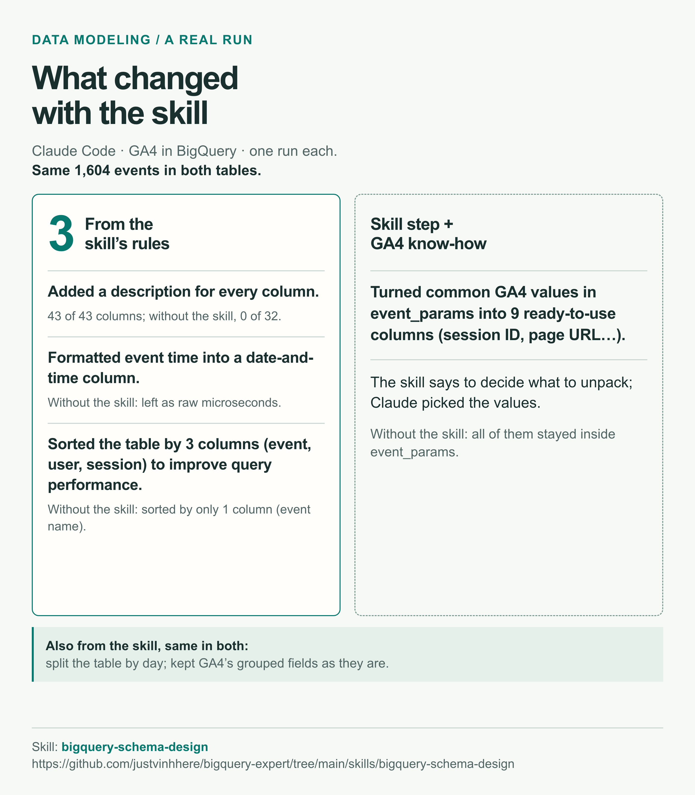
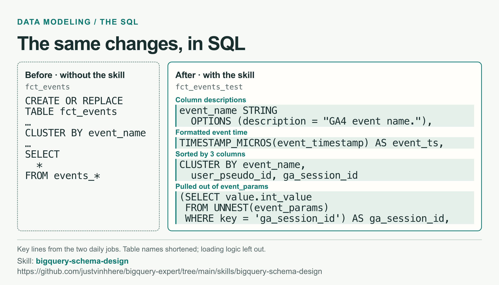
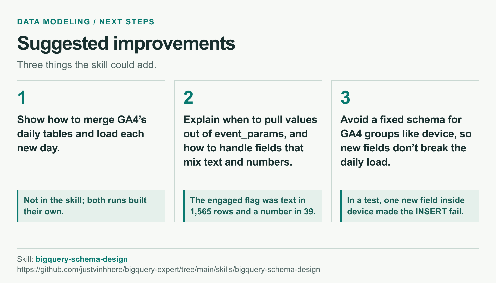

# bigquery-schema-design

**Verdict:** With the skill, Claude Code described each column, formatted event time, and sorted by 3 columns to improve query performance.

| Item | Detail |
| --- | --- |
| Skill | [`bigquery-schema-design`](https://github.com/justvinhhere/bigquery-expert/tree/main/skills/bigquery-schema-design) |
| Author | [justvinhhere/bigquery-expert](https://github.com/justvinhhere/bigquery-expert) |
| License | Apache-2.0 |
| Contents | `SKILL.md` and 6 guides; no scripts |
| skills.sh | [2 installs](https://www.skills.sh/justvinhhere/bigquery-expert/bigquery-schema-design) (checked 2026-10-26) |
| Tested with | Claude Code and BigQuery (`bq`) |
| Test data | 6 days of GA4 data, 1,604 events |
| Tested on | 2026-10-26 |

## Install

```bash
npx skills add https://github.com/justvinhhere/bigquery-expert --skill bigquery-schema-design
```

## How we ran it

1. Asked Claude Code twice to build one table from GA4's daily `events_YYYYMMDD` tables and load it daily.
2. One session built `fct_events` without the skill. Another ran `/bigquery-schema-design` and built `fct_events_test`.
3. Ran each version once.

## What changed



## Before and after SQL



Full SQL for both daily jobs, with placeholder project and dataset names.

### Before: `fct_events`, without the skill

```sql
CREATE OR REPLACE TABLE `your-project.your_dataset.fct_events`
PARTITION BY event_day
CLUSTER BY event_name
OPTIONS (description = 'Daily GA4 analytics_XXXXXXXXX events_YYYYMMDD tables, merged into one; event_day is parsed from event_date. Fully rebuilt every day at 23:30 UTC by the scheduled query "fct_events daily rebuild".')
AS
SELECT
  PARSE_DATE('%Y%m%d', event_date) AS event_day,
  *
FROM `your-project.analytics_XXXXXXXXX.events_*`
WHERE REGEXP_CONTAINS(_TABLE_SUFFIX, r'^\d{8}$');
```

### After: `fct_events_test`, with the skill

```sql
-- fct_events_test: one row per GA4 event, merged from the daily
-- analytics_XXXXXXXXX.events_YYYYMMDD export tables.
-- Runs daily as a BigQuery scheduled query. Each run rebuilds every day from
-- (latest loaded event_date - 3) onward, which picks up GA4's late updates
-- (up to 72h) and any missed runs. An empty table gets a full backfill.

DECLARE start_date DATE;

CREATE TABLE IF NOT EXISTS `your-project.your_dataset.fct_events_test` (
  event_date DATE OPTIONS (description = "Event date in the GA4 property timezone (America/Los_Angeles). Partition column."),
  event_ts TIMESTAMP OPTIONS (description = "Event time (UTC), from event_timestamp."),
  event_name STRING OPTIONS (description = "GA4 event name."),
  user_pseudo_id STRING OPTIONS (description = "GA4 client ID (pseudonymous device/browser ID)."),
  user_id STRING OPTIONS (description = "Logged-in user ID, when set."),
  ga_session_id INT64 OPTIONS (description = "event_params.ga_session_id."),
  session_key STRING OPTIONS (description = "Unique session key: user_pseudo_id.ga_session_id."),
  ga_session_number INT64 OPTIONS (description = "event_params.ga_session_number."),
  session_engaged BOOL OPTIONS (description = "event_params.session_engaged (sent as either string or int)."),
  engagement_time_msec INT64 OPTIONS (description = "event_params.engagement_time_msec."),
  page_location STRING OPTIONS (description = "event_params.page_location (full URL)."),
  page_path STRING OPTIONS (description = "Path of page_location, without query string or fragment."),
  page_title STRING OPTIONS (description = "event_params.page_title."),
  page_referrer STRING OPTIONS (description = "event_params.page_referrer."),
  event_timestamp INT64 OPTIONS (description = "GA4 event_timestamp, unchanged."),
  event_params ARRAY<STRUCT<key STRING, value STRUCT<string_value STRING, int_value INT64, float_value FLOAT64, double_value FLOAT64>>> OPTIONS (description = "GA4 event_params, unchanged."),
  event_previous_timestamp INT64 OPTIONS (description = "GA4 event_previous_timestamp, unchanged."),
  event_value_in_usd FLOAT64 OPTIONS (description = "GA4 event_value_in_usd, unchanged."),
  event_bundle_sequence_id INT64 OPTIONS (description = "GA4 event_bundle_sequence_id, unchanged."),
  event_server_timestamp_offset INT64 OPTIONS (description = "GA4 event_server_timestamp_offset, unchanged."),
  privacy_info STRUCT<analytics_storage STRING, ads_storage STRING, uses_transient_token STRING> OPTIONS (description = "GA4 privacy_info, unchanged."),
  user_properties ARRAY<STRUCT<key STRING, value STRUCT<string_value STRING, int_value INT64, float_value FLOAT64, double_value FLOAT64, set_timestamp_micros INT64>>> OPTIONS (description = "GA4 user_properties, unchanged."),
  user_first_touch_timestamp INT64 OPTIONS (description = "GA4 user_first_touch_timestamp, unchanged."),
  user_ltv STRUCT<revenue FLOAT64, currency STRING> OPTIONS (description = "GA4 user_ltv, unchanged."),
  device STRUCT<category STRING, mobile_brand_name STRING, mobile_model_name STRING, mobile_marketing_name STRING, mobile_os_hardware_model STRING, operating_system STRING, operating_system_version STRING, vendor_id STRING, advertising_id STRING, language STRING, is_limited_ad_tracking STRING, time_zone_offset_seconds INT64, browser STRING, browser_version STRING, web_info STRUCT<browser STRING, browser_version STRING, hostname STRING>> OPTIONS (description = "GA4 device, unchanged."),
  geo STRUCT<city STRING, country STRING, continent STRING, region STRING, sub_continent STRING, metro STRING> OPTIONS (description = "GA4 geo, unchanged."),
  app_info STRUCT<id STRING, version STRING, install_store STRING, firebase_app_id STRING, install_source STRING> OPTIONS (description = "GA4 app_info, unchanged."),
  traffic_source STRUCT<name STRING, medium STRING, source STRING> OPTIONS (description = "GA4 traffic_source, unchanged."),
  stream_id STRING OPTIONS (description = "GA4 stream_id, unchanged."),
  platform STRING OPTIONS (description = "GA4 platform, unchanged."),
  event_dimensions STRUCT<hostname STRING> OPTIONS (description = "GA4 event_dimensions, unchanged."),
  ecommerce STRUCT<total_item_quantity INT64, purchase_revenue_in_usd FLOAT64, purchase_revenue FLOAT64, refund_value_in_usd FLOAT64, refund_value FLOAT64, shipping_value_in_usd FLOAT64, shipping_value FLOAT64, tax_value_in_usd FLOAT64, tax_value FLOAT64, unique_items INT64, transaction_id STRING> OPTIONS (description = "GA4 ecommerce, unchanged."),
  items ARRAY<STRUCT<item_id STRING, item_name STRING, item_brand STRING, item_variant STRING, item_category STRING, item_category2 STRING, item_category3 STRING, item_category4 STRING, item_category5 STRING, price_in_usd FLOAT64, price FLOAT64, quantity INT64, item_revenue_in_usd FLOAT64, item_revenue FLOAT64, item_refund_in_usd FLOAT64, item_refund FLOAT64, coupon STRING, affiliation STRING, location_id STRING, item_list_id STRING, item_list_name STRING, item_list_index STRING, promotion_id STRING, promotion_name STRING, creative_name STRING, creative_slot STRING, item_params ARRAY<STRUCT<key STRING, value STRUCT<string_value STRING, int_value INT64, float_value FLOAT64, double_value FLOAT64>>>>> OPTIONS (description = "GA4 items, unchanged."),
  collected_traffic_source STRUCT<manual_campaign_id STRING, manual_campaign_name STRING, manual_source STRING, manual_medium STRING, manual_term STRING, manual_content STRING, manual_source_platform STRING, manual_creative_format STRING, manual_marketing_tactic STRING, gclid STRING, dclid STRING, srsltid STRING> OPTIONS (description = "GA4 collected_traffic_source, unchanged."),
  is_active_user BOOL OPTIONS (description = "GA4 is_active_user, unchanged."),
  batch_event_index INT64 OPTIONS (description = "GA4 batch_event_index, unchanged."),
  batch_page_id INT64 OPTIONS (description = "GA4 batch_page_id, unchanged."),
  batch_ordering_id INT64 OPTIONS (description = "GA4 batch_ordering_id, unchanged."),
  session_traffic_source_last_click STRUCT<manual_campaign STRUCT<campaign_id STRING, campaign_name STRING, source STRING, medium STRING, term STRING, content STRING, source_platform STRING, creative_format STRING, marketing_tactic STRING>, google_ads_campaign STRUCT<customer_id STRING, account_name STRING, campaign_id STRING, campaign_name STRING, ad_group_id STRING, ad_group_name STRING>, cross_channel_campaign STRUCT<campaign_id STRING, campaign_name STRING, source STRING, medium STRING, source_platform STRING, default_channel_group STRING, primary_channel_group STRING>, sa360_campaign STRUCT<campaign_id STRING, campaign_name STRING, source STRING, medium STRING, ad_group_id STRING, ad_group_name STRING, creative_format STRING, engine_account_name STRING, engine_account_type STRING, manager_account_name STRING>, cm360_campaign STRUCT<campaign_id STRING, campaign_name STRING, source STRING, medium STRING, account_id STRING, account_name STRING, advertiser_id STRING, advertiser_name STRING, creative_id STRING, creative_format STRING, creative_name STRING, creative_type STRING, creative_type_id STRING, creative_version STRING, placement_id STRING, placement_cost_structure STRING, placement_name STRING, rendering_id STRING, site_id STRING, site_name STRING>, dv360_campaign STRUCT<campaign_id STRING, campaign_name STRING, source STRING, medium STRING, advertiser_id STRING, advertiser_name STRING, creative_id STRING, creative_format STRING, creative_name STRING, exchange_id STRING, exchange_name STRING, insertion_order_id STRING, insertion_order_name STRING, line_item_id STRING, line_item_name STRING, partner_id STRING, partner_name STRING>> OPTIONS (description = "GA4 session_traffic_source_last_click, unchanged."),
  publisher STRUCT<ad_revenue_in_usd FLOAT64, ad_format STRING, ad_source_name STRING, ad_unit_id STRING> OPTIONS (description = "GA4 publisher, unchanged."),
  event_original_occurrence_timestamp INT64 OPTIONS (description = "GA4 event_original_occurrence_timestamp, unchanged."),
  source_table STRING OPTIONS (description = "GA4 daily table the row was loaded from."),
  loaded_at TIMESTAMP OPTIONS (description = "When the daily job loaded the row.")
)
PARTITION BY event_date
CLUSTER BY event_name, user_pseudo_id, ga_session_id
OPTIONS (
  description = "One row per GA4 web event, merged from the daily analytics_XXXXXXXXX.events_YYYYMMDD tables. Loaded by the 'fct_events_test daily' scheduled query.",
  labels = [("env", "test"), ("source", "ga4")]
);

SET start_date = (
  SELECT IFNULL(DATE_SUB(MAX(event_date), INTERVAL 3 DAY), DATE '1970-01-01')
  FROM `your-project.your_dataset.fct_events_test`
);

BEGIN TRANSACTION;

DELETE FROM `your-project.your_dataset.fct_events_test` WHERE event_date >= start_date;

INSERT INTO `your-project.your_dataset.fct_events_test` (
  event_date,
  event_ts,
  event_name,
  user_pseudo_id,
  user_id,
  ga_session_id,
  session_key,
  ga_session_number,
  session_engaged,
  engagement_time_msec,
  page_location,
  page_path,
  page_title,
  page_referrer,
  event_timestamp,
  event_params,
  event_previous_timestamp,
  event_value_in_usd,
  event_bundle_sequence_id,
  event_server_timestamp_offset,
  privacy_info,
  user_properties,
  user_first_touch_timestamp,
  user_ltv,
  device,
  geo,
  app_info,
  traffic_source,
  stream_id,
  platform,
  event_dimensions,
  ecommerce,
  items,
  collected_traffic_source,
  is_active_user,
  batch_event_index,
  batch_page_id,
  batch_ordering_id,
  session_traffic_source_last_click,
  publisher,
  event_original_occurrence_timestamp,
  source_table,
  loaded_at
)
SELECT
  PARSE_DATE('%Y%m%d', event_date) AS event_date,
  TIMESTAMP_MICROS(event_timestamp) AS event_ts,
  event_name,
  user_pseudo_id,
  user_id,
  ga_session_id,
  IF(ga_session_id IS NULL, NULL, CONCAT(user_pseudo_id, '.', CAST(ga_session_id AS STRING))) AS session_key,
  ga_session_number,
  session_engaged = 1 AS session_engaged,
  engagement_time_msec,
  page_location,
  IF(page_location IS NULL, NULL, IFNULL(NULLIF(REGEXP_EXTRACT(page_location, r'^[^:]+://[^/?#]+([^?#]*)'), ''), '/')) AS page_path,
  page_title,
  page_referrer,
  event_timestamp,
  event_params,
  event_previous_timestamp,
  event_value_in_usd,
  event_bundle_sequence_id,
  event_server_timestamp_offset,
  privacy_info,
  user_properties,
  user_first_touch_timestamp,
  user_ltv,
  device,
  geo,
  app_info,
  traffic_source,
  stream_id,
  platform,
  event_dimensions,
  ecommerce,
  items,
  collected_traffic_source,
  is_active_user,
  batch_event_index,
  batch_page_id,
  batch_ordering_id,
  session_traffic_source_last_click,
  publisher,
  event_original_occurrence_timestamp,
  CONCAT('events_', table_suffix) AS source_table,
  CURRENT_TIMESTAMP() AS loaded_at
FROM (
    SELECT
      *,
      _TABLE_SUFFIX AS table_suffix,
      (SELECT value.int_value FROM UNNEST(event_params) WHERE key = 'ga_session_id') AS ga_session_id,
      (SELECT value.int_value FROM UNNEST(event_params) WHERE key = 'ga_session_number') AS ga_session_number,
      (SELECT COALESCE(value.int_value, SAFE_CAST(value.string_value AS INT64)) FROM UNNEST(event_params) WHERE key = 'session_engaged') AS session_engaged,
      (SELECT value.int_value FROM UNNEST(event_params) WHERE key = 'engagement_time_msec') AS engagement_time_msec,
      (SELECT value.string_value FROM UNNEST(event_params) WHERE key = 'page_location') AS page_location,
      (SELECT value.string_value FROM UNNEST(event_params) WHERE key = 'page_title') AS page_title,
      (SELECT value.string_value FROM UNNEST(event_params) WHERE key = 'page_referrer') AS page_referrer
    FROM `your-project.analytics_XXXXXXXXX.events_*`
    WHERE REGEXP_CONTAINS(_TABLE_SUFFIX, r'^\d{8}$')
      AND _TABLE_SUFFIX >= FORMAT_DATE('%Y%m%d', start_date)
);

COMMIT TRANSACTION;
```

## Suggested improvements


