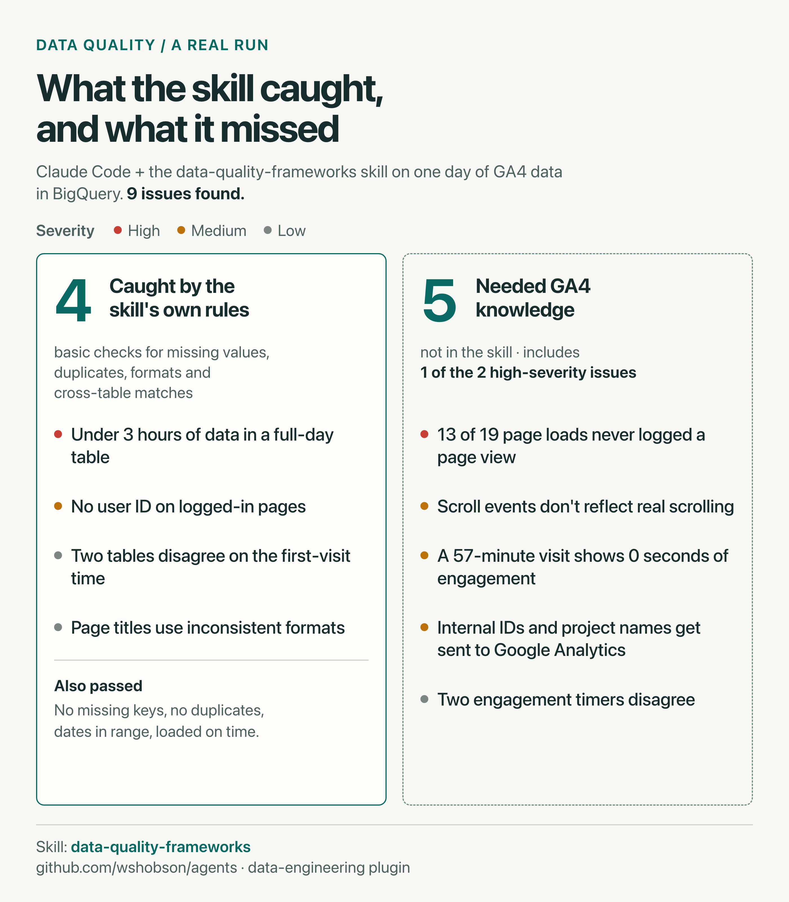
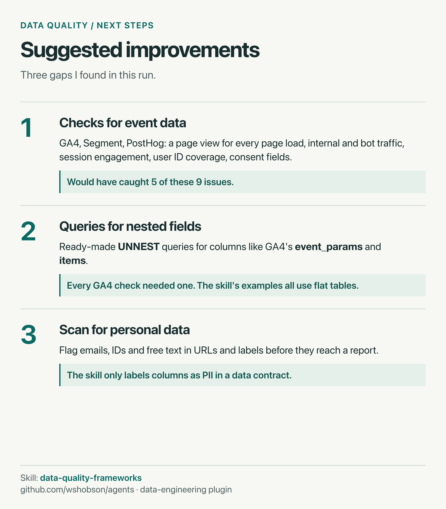

# data-quality-frameworks

**Verdict:** a good generic checklist for data quality. On one day of GA4 data in BigQuery, its own rules caught 4 of 9 issues. The other 5 needed GA4 knowledge the skill doesn't have.

| Item | Detail |
| --- | --- |
| Skill | [`data-quality-frameworks`](https://github.com/wshobson/agents/blob/main/plugins/data-engineering/skills/data-quality-frameworks/SKILL.md) |
| Author | Seth Hobson, [wshobson/agents](https://github.com/wshobson/agents) (data-engineering plugin) |
| License | MIT |
| What's inside | `SKILL.md` and `references/details.md`. Documentation only, no scripts |
| skills.sh | [11,269 installs](https://www.skills.sh/wshobson/agents/data-quality-frameworks); Gen, Socket and Snyk audits pass (read 2026-10-25) |
| Tested with | Claude Code and BigQuery (`bq` CLI) |
| Test data | One day of a GA4 export table |
| Tested on | 2026-10-25 |

## Install

With the skills CLI (works for Claude Code and Codex):

```bash
npx skills add https://github.com/wshobson/agents --skill data-quality-frameworks
```

Or inside Claude Code, install the whole data-engineering plugin:

```
/plugin marketplace add wshobson/agents
/plugin install data-engineering@claude-code-workflows
```

## How we ran it

1. Signed in to BigQuery with `gcloud auth login` and checked access with `bq ls`.
2. Asked Claude Code: `/data-quality-frameworks Check events_<date> and flag anything wrong`
3. Claude read the skill's checklist of six dimensions, then queried BigQuery in three steps, cheapest first: table metadata, a dry run to estimate cost, then the checks.

## What it caught, and what it missed



## Suggested improvements



## Good to know

- The skill is generic. Its examples use e-commerce tables (orders, customers) and never mention GA4 or BigQuery.
- Its Great Expectations examples mix the 0.x and 1.x APIs, so code copied as-is may fail on current versions.
- One section of `SKILL.md` is broken: a code fragment was left behind when content moved to `references/details.md`.
